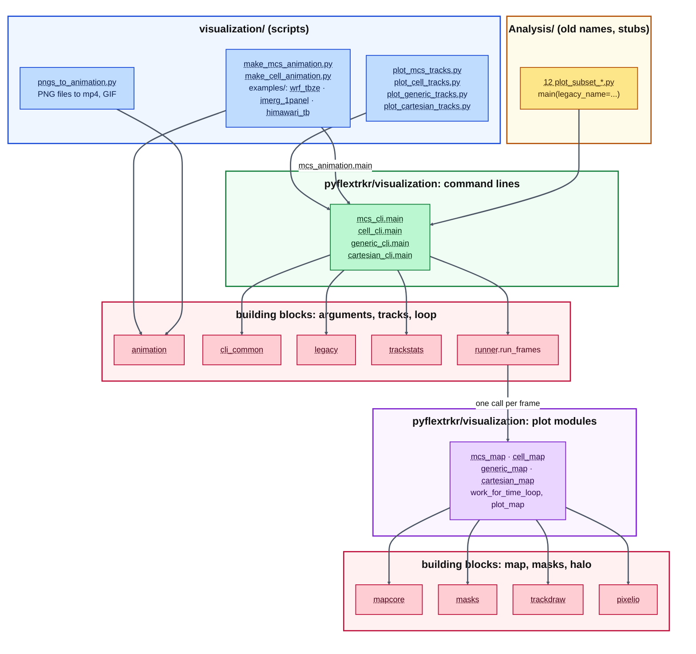
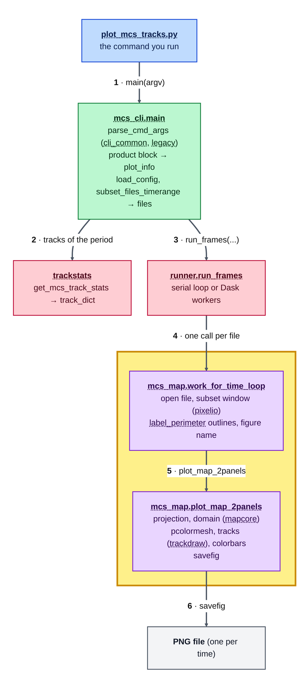

# Visualization code: structure, calls, where to change what

The track map scripts in [`visualization/`](../../visualization) are thin: a docstring that lists the options and one line that calls
`main()`. The code behind them is in [`pyflextrkr/visualization/`](../../pyflextrkr/visualization). This page is the map: which file does
what, who calls whom (so you can follow a call with *Go to Definition*), and which file to edit for a change.

- [The four families](#the-four-families)
- [Who calls what](#who-calls-what)
- [Call chain of one run](#call-chain-of-one-run)
- [Wrappers (animations) and the old `Analysis/` scripts](#wrappers-animations-and-the-old-analysis-scripts)
- [Why Go to Definition works](#why-go-to-definition-works)
- [Where to change what](#where-to-change-what)
- [How to add an option or a product](#how-to-add-an-option-or-a-product)

## The four families

A family is one kind of map. Each has a **plot module** (the plotting code: figure, axes, `pcolormesh`, tracks) and a **command-line module**
(arguments, the look of each product, the tracks and files of the period, the loop over the frames), and one script in `visualization/`.

| family | script in `visualization/` | command line (`pyflextrkr/visualization/`) | plot functions (same folder) | docs |
|---|---|---|---|---|
| **MCS maps**: Tb + precipitation (`tbpf`), Tb + radar reflectivity (`tbze`) or Tb only (`tb`); 1 or 2 panels | `plot_mcs_tracks.py` | `mcs_cli.py` | `mcs_map.py`: `plot_map_2panels`, `plot_map_1panel`, `work_for_time_loop` | [mcs_maps.md](mcs_maps.md) |
| **Convective cells**: composite reflectivity or echo-top height, radar range rings | `plot_cell_tracks.py` | `cell_cli.py` | `cell_map.py`: `plot_map`, `work_for_time_loop` | [cell_maps.md](cell_maps.md) |
| **Generic features**: any 2-D field (Z500, vorticity, stream function) with its tracks | `plot_generic_tracks.py` | `generic_cli.py` | `generic_map.py`: `plot_map`, `work_for_time_loop` | [generic_maps.md](generic_maps.md) |
| **x / y domains**: idealized simulations and cold pools without a map, optional periodic boundary | `plot_cartesian_tracks.py` | `cartesian_cli.py` | `cartesian_map.py`: `plot_map`, `work_for_time_loop` | [cartesian_maps.md](cartesian_maps.md) |

The building blocks that all families use, one topic per file (`pyflextrkr/visualization/`):

| module | what is in it |
|---|---|
| `mapcore.py` | projections by name (`PROJECTIONS`), the central longitude and the dateline set-up (`get_projections`), the visible domain with the latitude-band crop (`set_map_domain`), the domain of the data in the coordinates of the projection (`data_extent_xy`, `auto_map_domain`), figure size from the shape of the map (`projected_aspect`, `panel_fractions`, `figsize_for_aspect`), the colorbars that follow a map that keeps its shape (`fit_colorbars_to_maps`) and keep their text inside the figure (`keep_colorbar_text_inside`), the margins of a short figure (`figure_margins`), the latitude labels of whole-world maps (`lat_labels_on_boundary`), longitude helpers (`norm_lon`, `in_map_extent`), geodesic circles and lines for range rings, PF circles and azimuth lines (`geodesic_circle`, `geodesic_ray`) |
| `masks.py` | perimeter of every tracked object (`label_perimeter`, on the bounding box of each object, optional periodic wrap, `outer=True`: the ring just outside the objects), the structuring elements, the center of every object |
| `trackstats.py` | the tracks of a period as dictionaries: `get_mcs_track_stats`, `get_cell_track_stats`, `get_generic_track_stats`, `get_cartesian_track_stats` |
| `trackdraw.py` | the halo (path effects with their own alpha) of track paths, symbols and numbers; the colour levels of the track numbers; `draw_perimeter` (the outlines in one color or one color per track) |
| `pixelio.py` | the data extent, the index window of a map extent (`find_subset_window`, dateline safe), the figure name and title |
| `colors.py` | `concat_cmaps`, `truncate_colormap`, `named_colormap`, `cmap_colors` (all the colors of a colormap) |
| `runner.py` | `run_frames`: the loop over the pixel-level files, serial or on Dask workers |
| `animation.py` | ffmpeg: `frames_in_range`, `list_png_files`, `make_mp4` (PNG files -> mp4: speed, file frame rate, quality, even sizes, width), `make_gif`, `make_animation` (both, with the settings printed), `main` (the command line of `visualization/pngs_to_animation.py`) |
| `mcs_animation.py` | the animation of the MCS maps from the parameters of a wrapper script: the PNG files (`mcs_cli.main`), the mp4 and the GIF (`DEFAULTS` lists the parameters) |
| `cli_common.py` | the arguments that all families share, `options_to_argv`, `apply_track_style_args` |
| `legacy.py` | the defaults of the 12 old `Analysis/plot_subset_*.py` scripts (used only by their stubs) |

## Who calls what

Every block has its own color: **blue** the scripts in `visualization/`, **amber** the old `Analysis/` names (stubs), **green** the command lines,
**pink** the building blocks (twice: what the command line uses, and what the plot functions use), **purple** the plot modules. A node that lists
four names stands for the four families (the table above has one row for each); the arrows are the same for each of them.
**Click a name to open its source file** (in the preview of VS Code; GitHub does not make links in diagrams clickable, use the list below the diagram).



Source files: scripts [plot_mcs_tracks.py](../../visualization/plot_mcs_tracks.py), [plot_cell_tracks.py](../../visualization/plot_cell_tracks.py),
[plot_generic_tracks.py](../../visualization/plot_generic_tracks.py), [plot_cartesian_tracks.py](../../visualization/plot_cartesian_tracks.py);
wrappers [make_mcs_animation.py](../../visualization/make_mcs_animation.py), [make_cell_animation.py](../../visualization/make_cell_animation.py),
[examples](../../visualization/examples), [pngs_to_animation.py](../../visualization/pngs_to_animation.py); command lines [mcs_cli.py](../../pyflextrkr/visualization/mcs_cli.py), [cell_cli.py](../../pyflextrkr/visualization/cell_cli.py),
[generic_cli.py](../../pyflextrkr/visualization/generic_cli.py), [cartesian_cli.py](../../pyflextrkr/visualization/cartesian_cli.py);
plot modules [mcs_map.py](../../pyflextrkr/visualization/mcs_map.py), [cell_map.py](../../pyflextrkr/visualization/cell_map.py),
[generic_map.py](../../pyflextrkr/visualization/generic_map.py), [cartesian_map.py](../../pyflextrkr/visualization/cartesian_map.py); building blocks
[cli_common.py](../../pyflextrkr/visualization/cli_common.py), [legacy.py](../../pyflextrkr/visualization/legacy.py), [trackstats.py](../../pyflextrkr/visualization/trackstats.py),
[runner.py](../../pyflextrkr/visualization/runner.py), [animation.py](../../pyflextrkr/visualization/animation.py), [mcs_animation.py](../../pyflextrkr/visualization/mcs_animation.py),
[mapcore.py](../../pyflextrkr/visualization/mapcore.py), [masks.py](../../pyflextrkr/visualization/masks.py), [trackdraw.py](../../pyflextrkr/visualization/trackdraw.py),
[pixelio.py](../../pyflextrkr/visualization/pixelio.py); old names: [inventory.md](inventory.md#old-script---new-command).

The same chain as a tree (MCS maps; the other families replace the `mcs_*` names):

```
visualization/plot_mcs_tracks.py
└─ mcs_cli.main(argv)                              arguments, the look of each product, files and tracks of the period
   ├─ mcs_cli.parse_cmd_args                       cli_common.add_common_arguments + the MCS options (+ legacy.defaults)
   ├─ trackstats.get_mcs_track_stats               the tracks of the period -> track_dict
   └─ runner.run_frames(mcs_map.work_for_time_loop, ...)      serial loop or Dask: one call per pixel-level file
      └─ mcs_map.work_for_time_loop                reads one file, subsets it, makes the dictionaries
         ├─ pixelio.find_subset_window             index window of --extent (--subset 1)
         ├─ masks.label_perimeter                  outline of every tracked MCS
         ├─ pixelio.make_figure_name               file name and title
         └─ mcs_map.plot_map_2panels / plot_map_1panel      the plotting code (figure, axes, data, tracks, colorbars)
            ├─ mapcore.get_projections / set_map_domain     projection, central longitude, latitude-band crop
            └─ trackdraw.halo_effects                       halo of paths, symbols, numbers
```

## Call chain of one run

What `python visualization/plot_mcs_tracks.py -s ... -e ... -c config.yml` does, in order. Follow the numbers 1-6 from the top; the **yellow block** is the work for
one frame, done for every pixel-level file (serial, or on Dask workers); the two functions in it are in `mcs_map.py`. Click a name to open its source file (VS Code preview).



Source files: [plot_mcs_tracks.py](../../visualization/plot_mcs_tracks.py), [mcs_cli.py](../../pyflextrkr/visualization/mcs_cli.py)
([cli_common.py](../../pyflextrkr/visualization/cli_common.py), [legacy.py](../../pyflextrkr/visualization/legacy.py)),
[trackstats.py](../../pyflextrkr/visualization/trackstats.py), [runner.py](../../pyflextrkr/visualization/runner.py),
[mcs_map.py](../../pyflextrkr/visualization/mcs_map.py) (`work_for_time_loop`, `plot_map_2panels`), [pixelio.py](../../pyflextrkr/visualization/pixelio.py),
[masks.py](../../pyflextrkr/visualization/masks.py), [mapcore.py](../../pyflextrkr/visualization/mapcore.py), [trackdraw.py](../../pyflextrkr/visualization/trackdraw.py).

- The four dictionaries are the interface between the steps: `pixel_dict` (arrays of one frame), `plot_info` (look and options of the plot),
  `map_info` (extent, projection, coastlines, gridlines), `track_dict` (tracks of the period). Each plot function documents the keys it reads;
  a new option is one `plot_info.get(...)` line at the place where it acts.
- `runner.run_frames` runs the loop serially (`-p 0`) or on a Dask `LocalCluster` (`-p 1 --workers N`). The tracks are sent to every worker
  once (`client.scatter(..., broadcast=True)`), each frame is a task, and the workers use the `Agg` backend. Use a compute node for `-p 1`.
- The plot functions are the original plotting code of the old scripts (same variable names, order and comments); only the parts that were
  copied into every script (perimeter, centers, projection set-up, the Dask loop, colormap helpers) were moved into the building blocks.

## Wrappers (animations) and the old `Analysis/` scripts

```
visualization/make_mcs_animation.py              parameter block at the top (or --set NAME=VALUE): the global Robinson map
visualization/examples/make_mcs_animation_*.py   the same for the demo data (WRF Tb + reflectivity, IMERG 1 panel, Himawari Tb only)
└─ mcs_animation.main(globals())                 the parameters (DEFAULTS for those a script leaves out) -> the plot options
   ├─ cli_common.options_to_argv(options)        the parameters -> the list of arguments
   ├─ mcs_cli.main(argv)                         the same chain as above: one PNG per time
   └─ animation.frames_in_range / make_animation           the PNG files of the period -> mp4 (make_mp4, ffmpeg) -> GIF (make_gif)

visualization/make_cell_animation.py             parameter block at the top (or --set NAME=VALUE)
├─ cli_common.options_to_argv(options)
├─ cell_cli.main(argv)
└─ animation.frames_in_range / animation.make_animation

visualization/pngs_to_animation.py               PNG files that are already plotted (a directory, a pattern, a list)
└─ animation.main(argv)                          -> make_animation: mp4 (and GIF); --print_command: the plain ffmpeg commands

Analysis/plot_subset_tbze_mcs_tracks_demo.py     12 stubs, one per old script name, 4 lines each
└─ mcs_cli.main(legacy_name="plot_subset_tbze_mcs_tracks_demo")
   ├─ legacy.announce(name)                      one line on stderr: "this script has moved to ..."
   └─ legacy.defaults(name) -> parser.set_defaults(...)      the defaults of that old script (product, dpi, skip_empty, ...)
```

The old commands take the same arguments as before; an option on the command line replaces the default of the old script.
The table of old script -> new command is in [inventory.md](inventory.md).

## Why Go to Definition works

The call chain above is made of plain imports and plain function calls, so the editor can follow every step:

1. Static imports only: `from pyflextrkr.visualization.mcs_cli import main` (no `sys.path` edits, no `importlib`, no `getattr` or
   dictionary of functions to choose a plot). The choice of a product or of the number of panels is an `if / elif` that calls the function.
2. The wrappers call `main(argv)` directly, **not** a subprocess with the script name, so the wrapper -> command line -> plot function path
   can be followed (the argument names are the long option names of the script, see `options_to_argv`).
3. Every module has a docstring that says "Called by / Calls", and `pyflextrkr/visualization/__init__.py` has the module map.
4. `tests/test_viz_cli.py` checks rules 1-2 (AST: no `sys.path`, no `subprocess` / `importlib`, every imported name exists) for the scripts and the stubs.

Typical steps in the editor: open `visualization/plot_mcs_tracks.py` -> *Go to Definition* on `main` -> `mcs_cli.py` -> on `run_frames` ->
`runner.py`, on `mcs_map.work_for_time_loop` -> `mcs_map.py` -> `plot_map_2panels` -> `get_projections` in `mapcore.py`.

## Where to change what

| I want to ... | edit |
|---|---|
| change the colours, levels, titles, colorbar labels of a product | the product block in `main()` of `mcs_cli.py` (`if product == 'tbpf' and panels == 2:` ...), `cell_cli.py` (`if product == 'eth':`), `generic_cli.py` |
| change how a panel is drawn (axes, shading, outlines, tracks, legend) | `plot_map_2panels` / `plot_map_1panel` in `mcs_map.py`; `plot_map` in `cell_map.py`, `generic_map.py`, `cartesian_map.py` |
| change the layout (grid of the panels, thickness of the colorbars, the gap between 2 colorbars) | `GRID_2PANELS`, `GRID_1PANEL`, `GRID_1PANEL_TBONLY`, `CBAR_THICKNESS`, `CBAR_SPACING` and `figure_layout` at the top of `mcs_map.py` (`GRID_MAP` in the other plot modules) |
| add or change a command-line option | `cli_common.py` (all families) or the `parse_cmd_args` of the family; then read it in `main()` and put it in `plot_info` / `map_info` |
| add a map projection | `PROJECTIONS` in `mapcore.py` |
| change the shape of the map, the figure size, or how the colorbars follow the map | `map_aspect` and `fit_colorbars_to_maps` calls in the plot functions (`mcs_map.py`, `cell_map.py`, `generic_map.py`), `auto_map_domain` and the figure size block of `main()` in the `*_cli.py`, `fit_colorbars_to_maps` / `data_extent_xy` in `mapcore.py` |, `keep_colorbar_text_inside` (the text of the colorbars stays inside the figure) and `figure_margins` (short figures) in `mapcore.py`
| change the latitude labels | `lat_labels_on_boundary` (whole-world maps) in `mapcore.py`; the gridliner blocks of the plot functions (other maps) |
| change the central longitude / dateline logic, the latitude-band crop | `get_projections`, `set_map_domain` in `mapcore.py` |
| change how the MCS outline is computed | `label_perimeter` in `masks.py` |
| change which tracks are drawn for a period | `get_*_track_stats` in `trackstats.py`; `--track_lookback_days`; `dt_thres` in `main()` |
| change the halo | `halo_effects` in `trackdraw.py` |
| change the animation (frame rate, size, quality, GIF) | the parameter block of `make_mcs_animation.py` / `examples/make_mcs_animation_*.py` / `make_cell_animation.py`; `DEFAULTS` of the parameters in `mcs_animation.py`; `make_mp4`, `make_gif`, `make_animation` in `animation.py` (the settings and their tests: [animations.md](animations.md)) |
| change how frames are run in parallel | `run_frames` in `runner.py` |
| restore a default of an old command | `legacy.py` |

## How to add an option or a product

**A new option** (example: the z-order of the track paths, `--track_zorder`), in three places and nowhere else:

1. `cli_common.py`: `parser.add_argument("--track_zorder", type=float, default=None, help=...)` (or in the `parse_cmd_args` of one family).
2. `apply_track_style_args` in `cli_common.py` (or `main()` of the family): `'track_zorder': 'trackpath_zorder'` puts it in `plot_info` only when it was given.
3. The plot function: `trackpath_zorder = plot_info.get('trackpath_zorder', 3)` next to the other `plot_info.get(...)` lines, and use it in `ax.plot(..., zorder=trackpath_zorder)`.

Without the option on the command line the plot is exactly as before, because the default is the old value.

**A new product** of a family (example: a second reflectivity variable for the MCS maps): add a branch to the product block of `main()`
in the family's `*_cli.py` (variable names, levels, colormap, labels, titles) and to `choices` of `--product`. If the layout differs,
add a `GRID_*` entry and the branch in the plot function; if only the variable differs, nothing in the plot function changes.

**A new family**: copy the smallest one (`generic_map.py` + `generic_cli.py`), a script in `visualization/` that calls `main()`, and a row in the
tables above.
